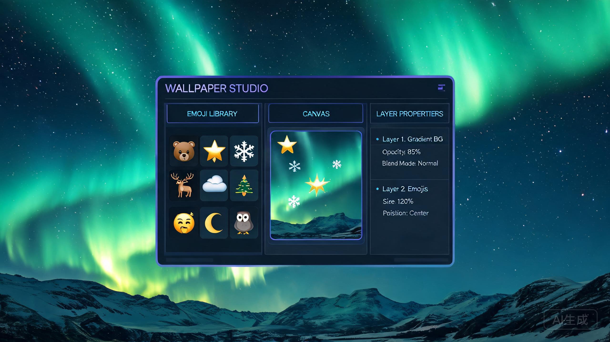

# 壁纸工坊 WallpaperMaker

<p align="center">
  
</p>

<p align="center">
  <a href="#功能特性"></a>
  <a href="#使用示例"></a>
  <a href="#快速开始"></a>
  <a href="#快速开始"></a>
  <a href="#快速开始"></a>
</p>

一款基于 **Python + pywebview + Canvas** 的 Windows 桌面壁纸制作与管理系统。内置 1045 个 Emoji 素材库，支持画布创作、壁纸中心、动态壁纸引擎、定时切换与以图搜图，界面运行在软件内置浏览器（WebView2）中。

> 本项目为个人学习交流项目，仅支持 Windows 10 / 11。

## 功能特性

### 画布编辑器
- **内置 Emoji 库**：9 大分类共 1045 个唯一 Emoji，支持中英文关键词搜索与分类浏览
- **素材管理**：本地图片加入/删除，自动生成缩略图
- **图层编辑**：拖拽、缩放、旋转，图层上下移、复制、删除，选中高亮
- **撤销 / 重做**：最多 60 步历史
- **背景设置**：纯色 / 渐变（角度可调）/ 图片背景
- **文字元素**：添加文字图层，字体字号颜色可调
- **导出**：PNG / JPG，多档分辨率预设（手机 1080×1920 到 4K 3840×2160）

### 壁纸中心
- **内置精选壁纸**：25 张程序化生成壁纸（渐变 / 极光 / 星空 / 波浪 / 山峦 / 几何 / 光斑等 12 类），启动时自动生成
- **动态壁纸**：极光、星空、波浪、时钟 4 套 HTML/Canvas 动画模板，基于 WorkerW 桌面宿主，动画显示在桌面图标**之下**
- **系统集成**：一键设为桌面壁纸 / 锁屏壁纸 / 立即切换，支持跨屏拼接（多显示器）
- **以图搜图**：基于感知哈希（dHash）+ 汉明距离的本地相似壁纸检索

### 系统控制
- **静态壁纸**：SystemParametersInfo + 注册表双写，支持填充 / 适应 / 拉伸 / 居中 / 平铺 / 跨屏
- **定时切换**：后台调度线程，按间隔自动轮换（顺序 / 随机）
- **节能模式**：检测全屏应用与笔记本电池状态，自动暂停动态壁纸渲染
- **多显示器**：按虚拟桌面逻辑坐标定位，动态壁纸每屏独立或整屏拼接

## 使用示例

### 示例 1：用 Emoji 制作一张壁纸

1. 启动应用后进入**编辑器**页签，右侧选尺寸预设（如 1920×1080）
2. 左侧素材面板搜索 `星星` 或展开「活动与庆典」分类，点击 Emoji 加入画布
3. 画布中拖拽移动、滚轮缩放、拖动手柄旋转，右侧面板调整图层顺序
4. 设置渐变背景（默认已给蓝橙渐变，可改角度与颜色）
5. 点击工具栏「导出」，选择 PNG 与分辨率，成品保存到 `assets/exports/`

程序化生成的内置壁纸效果参考：

| 极光青绿（内置精选 09） | 星空银河（内置精选 12） | 碧海波浪（内置精选 15） |
| --- | --- | --- |
|  |  |  |

### 示例 2：启用动态壁纸

1. 进入**壁纸中心**页签，上方是 4 张动态壁纸模板卡片（极光 / 星空 / 波浪 / 时钟），支持实时动画预览
2. 点击目标模板的「启用」：约 1~2 秒后动画出现在桌面图标之下（WorkerW 宿主窗口）
3. 顶栏状态条显示「● 动态壁纸运行中」，再次点击同卡「停止」恢复静态壁纸
4. 多显示器时可在**设置**页选择「每屏独立」；开启「点击穿透」后鼠标可正常操作桌面

### 示例 3：定时自动切换壁纸

1. 进入**设置**页签，开启「定时切换」
2. 间隔设为 30 分钟，来源选「壁纸库」，顺序选「随机」
3. 应用会按配置轮换桌面壁纸，无需驻留额外进程（调度线程随应用常驻）

### 示例 4：命令行 / HTTP API

本地服务默认运行在 `http://127.0.0.1:8000`，可直接用 curl 调用：

```bash
# 将壁纸库中的星空银河设为桌面壁纸（适应模式）
curl -X POST http://127.0.0.1:8000/api/wallpaper/set \
  -H "Content-Type: application/json" \
  -d '{"file": "wallpapers/builtin/12-星空银河.png", "mode": "fit"}'

# 设为锁屏壁纸
curl -X POST http://127.0.0.1:8000/api/wallpaper/lock \
  -H "Content-Type: application/json" \
  -d '{"file": "wallpapers/builtin/09-极光青绿.png"}'

# 启用极光动态壁纸
curl -X POST http://127.0.0.1:8000/api/dynamic/start \
  -H "Content-Type: application/json" \
  -d '{"wallpaper": "aurora"}'

# 查询动态壁纸状态
curl http://127.0.0.1:8000/api/dynamic/status

# 以图搜图：上传图片后检索相似壁纸
curl -X POST http://127.0.0.1:8000/api/wallpaper/search \
  -H "Content-Type: application/json" \
  -d '{"file": "assets/images/xxx.png"}'

# 立即切换（顺序轮换）
curl -X POST http://127.0.0.1:8000/api/wallpaper/next
```

常用 API 一览：

| 接口 | 方法 | 说明 |
| --- | --- | --- |
| `/api/wallpaper/set` | POST | 设为桌面壁纸（mode: fit/fill/stretch/center/tile/span） |
| `/api/wallpaper/lock` | POST | 设为锁屏壁纸 |
| `/api/wallpaper/next` | POST | 立即切换壁纸 |
| `/api/wallpaper/library` | GET | 壁纸库列表 |
| `/api/wallpaper/generate` | POST | 生成精选壁纸 |
| `/api/wallpaper/import` | POST | 导入图片到壁纸库 |
| `/api/wallpaper/search` | POST | 以图搜图（dHash） |
| `/api/dynamic/start` / `stop` | POST | 启用 / 停止动态壁纸 |
| `/api/dynamic/status` | GET | 动态壁纸状态与节能暂停信息 |
| `/api/dynamic/templates` | GET | 动态壁纸模板列表 |
| `/api/config` | GET/POST | 读写全局配置 |

## 快速开始

### 环境要求
- Windows 10 / 11（需预装 WebView2 Runtime，Win10/11 通常自带）
- Python 3.10+（开发环境使用 3.14）

### 安装依赖
```bash
pip install -r requirements.txt
```

### 运行
```bash
python main.py
```
首次启动会自动生成内置壁纸与素材库，之后每次打开「壁纸工坊」窗口即可使用。

## 使用指南

- **编辑器**：左侧选择 Emoji 分类/搜索，点击添加到画布；拖拽移动、滚轮缩放、拖动手柄旋转；右侧面板管理图层、背景与画布尺寸；导出按钮保存到 `assets/exports/`
- **壁纸中心**：切换页签浏览动态模板 / 内置精选 / 我的壁纸；卡片上「设为壁纸」「锁屏」「立即切换」「启用动态」直接生效
- **设置**：配置定时切换（间隔 / 顺序 / 来源）、节能模式（全屏 / 电池暂停）、动态壁纸（每屏独立 / 点击穿透）、默认显示模式，改动即时保存到 `config.json`

## 技术架构

```
┌─────────────────────────────────────────────┐
│  软件外壳层  main.py（pywebview 原生窗口）    │
├─────────────────────────────────────────────┤
│  前端界面层  static/（HTML + Canvas + JS）    │
│  编辑器 | 壁纸中心 | 设置  三页签             │
├─────────────────────────────────────────────┤
│  本地服务层  server.py（HTTP + 素材/壁纸 API）│
├─────────────────────────────────────────────┤
│  核心层 core/                                │
│  config 配置 · win32 系统控制 · generate 生成│
│  scheduler 定时 · dynamic 动态引擎           │
└─────────────────────────────────────────────┘
```

### 动态壁纸原理
1. 向桌面 `Progman` 窗口发送 `0x052C` 消息，创建 `WorkerW` 宿主窗口（桌面图标之下、壁纸之上）
2. 用 pywebview 创建全屏无边框窗口，加载动态模板页（`wallpapers/dyn/*.html`）
3. 通过 `SetParent` 将窗口重定向到 WorkerW 宿主，即可让动画显示在图标之下
4. 节能模式：全屏应用或电池供电时暂停 `requestAnimationFrame` 渲染

## 目录结构

```
wallpaper-maker/
├── main.py              # 程序入口：服务线程 + pywebview 窗口
├── server.py            # 本地 HTTP 服务与全部 API
├── requirements.txt     # 依赖清单
├── build.ps1            # PyInstaller 打包脚本
├── wallpaper.spec       # PyInstaller 配置
├── docs/                # 文档与截图
│   ├── hero.jpg         #   README 头图
│   └── screenshots/     #   内置壁纸效果示例
├── core/                # 核心层
│   ├── config.py        #   JSON 配置持久化（线程安全）
│   ├── win32.py         #   Windows 系统控制（壁纸/锁屏/显示器/WorkerW）
│   ├── generate.py      #   程序化壁纸生成 + dHash 以图搜图
│   ├── scheduler.py     #   定时切换壁纸线程
│   ├── dynamic.py       #   动态壁纸引擎（WorkerW 宿主 + 节能暂停）
│   └── assets_gen.py    #   内置素材库生成
├── static/              # 前端
│   ├── index.html       #   三页签界面
│   ├── style.css        #   深色设计工具风样式
│   ├── app.js           #   画布编辑器逻辑
│   ├── wallpaper.js     #   壁纸中心/设置逻辑
│   ├── editor-render.js #   文字/绘制渲染
│   └── emoji_data.js    #   Emoji 库数据（9 类 1045 个）
└── wallpapers/
    ├── builtin/         #   程序化生成的内置壁纸（首次启动自动生成）
    └── dyn/             #   动态壁纸 HTML 模板
```

## 打包为独立 exe

```bash
# 在项目根目录执行
.\build.ps1
# 或
pyinstaller wallpaper.spec
```
产物输出到 `dist/WallpaperMaker/`，双击 `WallpaperMaker.exe` 即可运行（无需安装 Python）。

## 常见问题

| 问题 | 说明 |
| --- | --- |
| 动态壁纸不显示 | 首次启用需 1~2 秒创建宿主窗口；如仍异常，检查设置页「动态壁纸」总开关是否开启 |
| 以 file:// 打开页面无素材 | 请通过 `python main.py` 以本地服务方式访问 `http://127.0.0.1:8000` |
| 壁纸库为空 | 首次启动自动生成内置壁纸，稍等片刻后刷新壁纸中心 |
| 设置壁纸无反应 | 确认系统壁纸轮换未开启，且当前用户有桌面背景修改权限 |

## 免责声明

- 本项目仅用于个人学习与交流，请勿用于商业用途
- 内置 Emoji 数据版权归 Unicode 联盟及其各供应商所有
- 使用本项目造成的任何系统壁纸设置变更与用户自行承担相关风险

---

## 同作者的其它项目

| 项目 | 说明 |
|---|---|
| [**antivirus-software**](https://github.com/zhao1136-art/antivirus-software) | 御天 Windows 安全防护套件：YARA 规则 + 9 个 ETW provider + C++ 原生层 + 沙箱 + 跨引擎确认 |
| [**yutian-guardian-ai**](https://github.com/zhao1136-art/yutian-guardian-ai) | 二进制转灰度图 + 轻量 CNN + OOD 四态融合判定的 AI 检测分支 |
| [**memory-optimizer**](https://github.com/zhao1136-art/memory-optimizer) | 纯 C 写的 Windows 内存分析工具（采样 / 泄漏识别 / 碎片 / 热点 / PDF 报告） |
| [**poetry-duel-platform**](https://github.com/zhao1136-art/poetry-duel-platform) | AI 自动对诗平台：对联 / 接龙 / 唱和 / 飞花令，三通道自动降级 |
| [**SleepPostponeTool**](https://github.com/zhao1136-art/SleepPostponeTool) | 电脑休眠推迟工具（SetThreadExecutionState，零依赖单文件 exe） |
